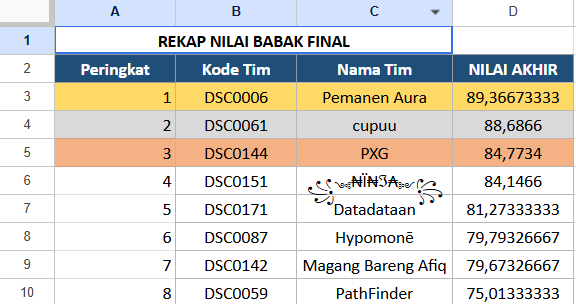
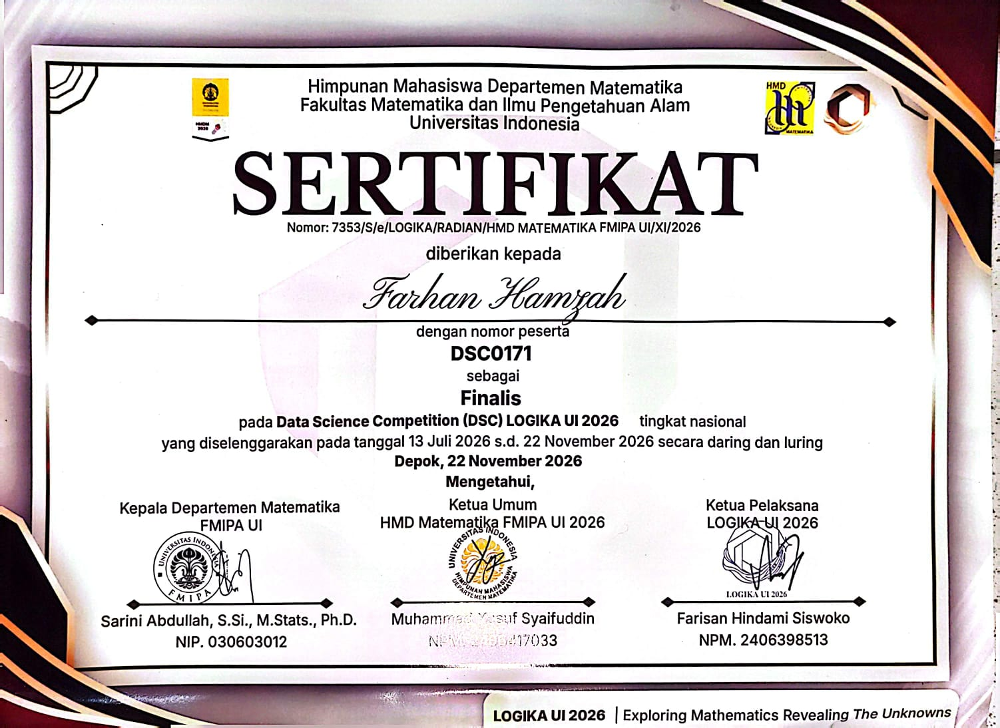

# PRISM — Data Science Competition (DSC) LOGIKA UI 2026

> **Prior-Informed Structural Repayment Modeling with Empirical-Bayes Markov Chains for 90-DPD Credit Default Prediction**

[](https://github.com/)
[-orange?style=for-the-badge)](#final-results--achievements)
[-2e7d32?style=for-the-badge)](#team-members)
[](#team-members)

---

## Overview

This repository contains the end-to-end solution, presentation deck, and official documentation of **Team Datadataan (`DSC0171`)** for the **Data Science Competition (DSC) LOGIKA UI 2026** (*Exploring Mathematics Revealing The Unknowns*), organized by Himpunan Mahasiswa Departemen Matematika, FMIPA Universitas Indonesia (July 13 – November 22, 2026).

Our team advanced to the **National Final Round** (top 8 finalists) and finished **5th Place Overall** with a final score of **81.2733**.

---

## Problem Statement

The task is to predict whether a new 12-month loan application will reach **90+ Days Past Due (90 DPD)** using strictly pre-decision historical data, evaluated by the **Kolmogorov–Smirnov (KS) statistic**.

| Dataset Summary | Details |
|---|---|
| Training samples | 70,000 applications (`13.58%` default rate) |
| Loan tenor | 12 monthly installments |
| Cold-start segment | ~34% of applicants have no prior installment history |
| Evaluation metric | Kolmogorov–Smirnov (KS) statistic (with ROC-AUC as secondary diagnostic) |

### Relational Data Sources

| Table | Coverage | Rows |
|---|---|---|
| Customer profile (`applications`) | 100% | 100,000 |
| Previous loan applications | 70% | 201,984 |
| Installment repayment history | 66% | 1,361,341 |
| Bank account mutations | 70% | 1,084,418 |
| Credit bureau reports | 100% | 797,563 |
| E-commerce transactions | 100% | 4,359,817 |

---

## Methodology: PRISM

1. **Leakage-Free EDA & Validation**
   - Verified zero temporal leakage across all tables relative to each applicant's `decision_datetime`.
   - Observed stable monthly bad rates (12–15%) and matching train/test distributions, validating `StratifiedKFold(5)` with paired bootstrap and multi-seed checks.
   - Preserved informative missingness (~34% cold-start applicants) as native `NaN` for GBDTs and explicit missingness indicators for linear models.

2. **Structural Repayment Modeling & Feature Engineering (`fin_sh2` — 462 Features)**
   - **Base & Behavioral Blocks (A–J, K1–K4, N2–N9):** Pre-decision recency windows capturing e-commerce spending surges, account outflow spikes, bureau inquiry trends, and price-premium behavior.
   - **Empirical-Bayes Markov Chain Structural Model (N16–N18csh):** Modeled monthly pay/skip transitions driven by total monthly debt-to-income (DTI) burden and simulated 12-month default probabilities.
   - **Universal Prior $\theta$ Refinement:** Estimated the applicant-level prior $\theta$ strictly from universally available covariates (application, profile, bureau, e-commerce), improving generalization especially for cold-start applicants without repayment history.

3. **Model Zoo & Non-Negative Rank-Normal Ensemble**
   - Combined **21 diverse models** across 3 feature sets (`14 × fin_sh2`, `4 × kn17_sh`, `3 × kn16`) spanning:
     - **LightGBM `leaves7`** (shallow trees, `num_leaves=7`, multi-seed)
     - **LightGBM Extra-Trees** & **Interaction-Constrained (`l7_ic`)**
     - **LightGBM Structural-Offset (`*_off`)** boosted directly from calibrated structural log-PD
     - **XGBoost** (`max_depth=4`) & **CatBoost** (`depth=6`)
     - **Logistic Regression** (Quantile-Normal transform + missing indicators)
   - Predictions are rank-normal transformed and combined with non-negative weights validated via nested CV.

---

## Key Quantitative Results

| Model / Pipeline | Nested / OOF KS | Nested / OOF AUC | Notes |
|---|---:|---:|---|
| Best Single Model (`lgb_extra_off_fin_sh2`) | 0.5332 | 0.8501 | Structural-offset LightGBM |
| Ensemble (before prior $\theta$ refinement) | 0.5317 | 0.8500 | Baseline structural prior |
| **Final 21-Model Ensemble (`sub_final_inference.csv`)** | **0.5346** | **0.8506** | **Public LB KS: `0.57449`** |

---

## Repository Structure

```text
DSC/
├── notebooks/
│   └── DSC0171_Datadataan_Notebook-FullTrain.ipynb   # Full EDA, FE, training, ensemble & export pipeline
├── docs/
│   ├── DSC0171_Datadataan_Presentasi.pdf             # Final round presentation deck (25 slides)
│   └── SK_Finalis_DSC_LOGIKA_UI_2026.pdf             # Official Finalist Decree (Surat Keputusan)
├── assets/
│   ├── final_leaderboard.png                         # Final round score recap
│   └── certificate_farhan_hamzah.jpeg                # Official Finalist Certificate
├── requirements.txt                                  # Python dependencies
├── .gitignore
└── README.md
```

---

## Reproducibility

1. Install dependencies:
   ```bash
   pip install -r requirements.txt
   ```
2. Place the competition CSV datasets (`train_applications.csv` and companion tables) into the `DATA_DIR` configured in Section 0 of [`notebooks/DSC0171_Datadataan_Notebook-FullTrain.ipynb`](notebooks/DSC0171_Datadataan_Notebook-FullTrain.ipynb).
3. Run the notebook from top to bottom (*Run All*) to reproduce EDA, feature blocks (`fin_sh2`), 5-fold CV training, nested ensemble evaluation, and model export.

> **Note:** Raw competition datasets are excluded from this repository in accordance with competition rules.

---

## Final Results & Achievements

- **Status:** National Finalist — **5th Place Overall** (Final Score: **81.2733**)
- **Official Decree:** [`docs/SK_Finalis_DSC_LOGIKA_UI_2026.pdf`](docs/SK_Finalis_DSC_LOGIKA_UI_2026.pdf)
- **Presentation Deck:** [`docs/DSC0171_Datadataan_Presentasi.pdf`](docs/DSC0171_Datadataan_Presentasi.pdf)

<p align="center">
  
</p>

<p align="center">
  
</p>

---

## Team Members

**Team Datadataan (`DSC0171`) — Telkom University**

| No | Name |
|---:|---|
| 1 | Farhan Hamzah |
| 2 | Adison Simanullang |
| 3 | Nazal Putra Pindha Dharmawara |
